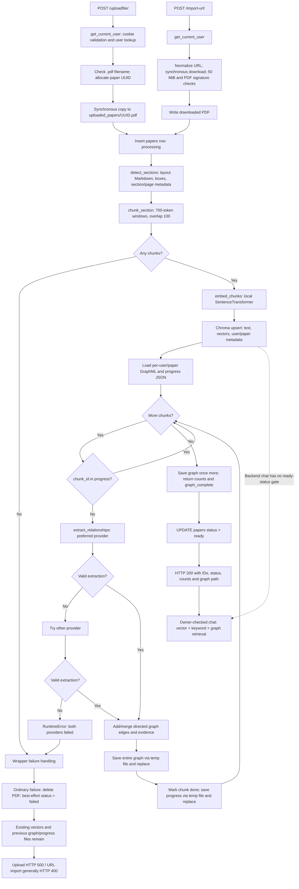

# PaperPilot: Complete PDF Ingestion Architecture Report

**Source review date:** 4 November 2026 (Asia/Karachi)  
**Project root:** `F:\paper pilot\project`  
**Scope:** Current backend ingestion, its authentication/storage dependencies, and the handoff to retrieval and chat. Frontend source was inspected only to establish what processing state is visible to users.

## 1. Scope, evidence, and investigation limits

This report is based on the current source files, not earlier versions of PaperPilot or comments describing intended behavior. Paths below are relative to the project root; for example, `backend/Graph_Rag/ingestion.py` means `F:\paper pilot\project\backend\Graph_Rag\ingestion.py`.

Only this requested report is an output artifact. No backend or frontend source, database, PDF, configuration, test, or dependency file was changed. No backend modules were imported or executed: importing several of them would create directories/databases, initialize provider clients, or load models. No upload, PDF conversion, model inference, provider request, database mutation, or new test was run.

Evidence labels used throughout:

- **Confirmed:** Explicit source behavior or a directly verified local configuration.
- **Conditional consequence:** What the confirmed implementation does under a stated input, failure, deployment, or concurrency condition. This is not a claim that the condition has occurred in production.
- **Not established:** Requires runtime measurement, credentials, a specific PDF, or deployment information not examined here.
- **Recommendation:** Proposed future design, not functionality that currently exists.

The local `backend/.venv` contains Groq 1.7.0, OpenAI 3.42.1, ChromaDB 1.5.9, PyMuPDF4LLM 1.28.2, and sentence-transformers 6.2.0 metadata. Relevant SDK implementation files were read to verify retry defaults. These observations do not prove that a separately deployed server uses this environment. Secret values, environment files, user records, document contents, authentication cookies, and API credentials were not read or reproduced.

Source anchors are function-definition or relevant call-site line numbers at review time. Line numbers can change after future edits.

## 2. Main findings

1. Upload processing is synchronous work inside an async HTTP handler. The request waits for text extraction, embeddings, vector storage, and a sequential graph-extraction loop.
2. Vectors are persisted **before** graph extraction. A later graph/provider failure can leave searchable vectors and earlier graph checkpoints on disk while the paper is marked `failed` and its PDF is deleted.
3. Each graph chunk not present in the progress set receives an LLM extraction attempt, including front matter and references. A valid empty extraction is still marked processed.
4. Extraction has two-provider fallback. Both providers failing raises `RuntimeError`; the ingestion loop catches Groq `RateLimitError` and `BadRequestError` instead. Those stop/skip handlers do not implement the intended provider-failure behavior for the current extractor.
5. Graph and progress files are separately replaced atomically, but are not one transaction. The order protects against marking an unsaved graph complete, but does not provide exactly-once processing.
6. There is no durable job queue, startup recovery, same-paper resume endpoint, upload idempotency key, or persisted per-stage error/progress record.
7. HTTP routes derive ownership from the authenticated cookie. Paper SQL operations and vector retrieval are owner-filtered; graph and checkpoint files are owner/paper scoped. No direct cross-user retrieval leak was confirmed in the inspected API paths.
8. Provider preference is process-global and shared across users. It affects availability/routing, not document isolation.
9. The graph is a `DiGraph`: multiple relations with the same directed source/target overwrite one another's relation label while combining evidence records. This is a confirmed evidence-integrity problem.
10. Storage roots are inconsistent: the paper registry, uploaded PDFs, and graph directory depend on the working directory; auth/chat SQLite and Chroma storage are anchored to the backend directory.
11. The durable paper states are only `processing`, `ready`, and `failed`. The upload response contains graph-completeness counters, but paper listing does not expose them and the frontend does not present a partial-ingestion state.
12. Chat error handling can convert operational failures into “answer not found,” and the backend's current confidence label differs from the frontend parser's expected label.

## 3. Complete execution flow

### 3.1 Startup and import-time dependencies

Before a request is handled:

- `backend/main.py` imports upload, question, authentication, and conversation modules.
- `backend/Graph_Rag/paper_registry.py` runs `initialize_db()` at module import and creates the `papers` table if needed in working-directory-relative `paperpilot.db`.
- `backend/api/upload.py` creates working-directory-relative `uploaded_papers/` at import.
- `backend/Graph_Rag/embeddings.py` loads `SentenceTransformer("all-MiniLM-L6-v2")` into a module-global model.
- `backend/Graph_Rag/vector_store.py` opens a persistent Chroma client at `backend/chroma_data` and obtains the `paperpilot_chunks` collection.
- `backend/Graph_Rag/graph_relationship.py` constructs Groq and OpenRouter clients. Both are constructed unconditionally.
- The question import chain loads the cross-encoder in `retriever.py` and another pair of provider clients in `answer_generator.py`.
- FastAPI's `lifespan()` calls `database.initialize.initialize_database()`, which creates auth/conversation/message tables and indexes and requests SQLite WAL mode.

Consequences: cold start includes model initialization, and missing provider credentials can prevent import/startup before fallback can run. “Fallback provider” does not mean its client is optional at initialization. Model cache availability, cold-download time, OCR availability, and startup latency were not measured.

### 3.2 Authentication and upload validation

**Entry:** `POST /uploadfile/` -> `backend/main.py:create_upload_file()` at line 111.

1. FastAPI requires a multipart `file` field.
2. `Depends(get_current_user)` reads and validates the HTTP-only authentication cookie and loads the current user from SQLite.
3. The route passes `current_user["id"]` to `upload_paper()`. No request-supplied `user_id` is used.
4. `upload_paper(file, user_id)` accepts a filename with a case-insensitive `.pdf` suffix.
5. A UUID4 becomes the `paper_id`; the on-disk name is `<paper_id>.pdf`, not the supplied filename.
6. `shutil.copyfileobj(file.file, saved_file)` copies the upload to disk synchronously.

**Important boundary:** The upload branch does not check MIME type, PDF magic bytes, file size, page count, encryption, or parser resource budgets before registration. `MAX_PDF_SIZE = 50 * 1024 * 1024` exists in this module but is enforced only in URL import. Frontend size checks are not backend enforcement.

The suffix check occurs before the function's `try/finally`, so the explicit `await file.close()` covers the main processing block, not the early invalid-filename branch. Framework-managed cleanup is separate.

### 3.3 Paper registration

After saving the file, `upload_paper()` calls:

```text
add_paper(paper_id, user_id, original_filename, relative_pdf_path, "processing")
```

`paper_registry.add_paper()` inserts into:

```text
papers(
  paper_id TEXT PRIMARY KEY,
  user_id TEXT NOT NULL,
  filename TEXT NOT NULL,
  file_path TEXT NOT NULL,
  status TEXT NOT NULL,
  created_at TIMESTAMP DEFAULT CURRENT_TIMESTAMP
)
```

The registry uses parameterized SQL and a connection transaction context. The insert is separate from all Chroma and graph writes. There is no `updated_at`, error text, progress count, stage, attempt count, file digest, pipeline version, or foreign key to `users`.

### 3.4 PDF text extraction

`upload_paper()` calls `process_paper(pdf_path, paper_id, user_id)`.

Its first operation is `detect_sections(pdf_path)` in `chunker.py`, which invokes:

```python
pymupdf4llm.to_markdown(pdf_path, page_chunks=True)
```

The application expects each page result to include:

- `metadata.page_number`;
- complete page `text`;
- `page_boxes` containing `class` and text-position offsets `pos`.

It slices each box from the page Markdown using those offsets. Non-empty box text drives all later processing; a full independent copy of every PDF page is not used as a fallback if box metadata is absent.

This is layout-assisted local extraction, not a Groq or OpenRouter call. The module imports `pymupdf.layout` before PyMuPDF4LLM.

**OCR qualification:** The application does not explicitly configure OCR. The locally inspected PyMuPDF4LLM layout wrapper defaults to `use_ocr=True`, `force_ocr=False`, and English OCR selection; its document parser disables OCR if no usable engine is available. It would be inaccurate to say “the app implements OCR” or “OCR is definitely absent.” Successful extraction from scanned PDFs was not established. The local layout implementation derives its page number from `page.number + 1`.

### 3.5 Section detection

`detect_sections()`:

- Skips boxes classified as `title`; document-title text is therefore omitted from the section body.
- Treats `section-header` boxes as heading candidates.
- Removes leading Markdown hashes and surrounding asterisks/spaces.
- Recognizes a set of common headings, such as abstract, introduction, methods, results, discussion, references, acknowledgements, and appendix.
- Also recognizes numeric headings matching the configured regex, such as `2.3 Method`.
- Before the first accepted section, stores regular text and unrecognized headers in `Front Matter`.
- After a section exists, accepts subsequent boxes classified as section headers without requiring membership in the common-heading set.
- Associates body text with the most recent section, preserving text per page.

Returned section shape:

```text
{
  section: string,
  page_start: page number or None,
  page_end: page number or None,
  page_texts: {page_number: text},
  text: accumulated section text
}
```

A heading is stored as the section name rather than repeated in that section's body text. Heading-only sections can remain in the section count but generate no chunks. An unknown header on the first page is not necessarily treated like that same header after a recognized section. These are explicit heuristics, not semantic section classification by an LLM.

### 3.6 Token chunking

`chunk_section(sections, paper_id, chunk_size=700, overlap=100)`:

1. Validates positive chunk size and `0 <= overlap < chunk_size`.
2. Sorts each section's page texts by page number.
3. Uses `tiktoken.get_encoding("cl100k_base")` to tokenize page text.
4. Builds a parallel array mapping each token to its page.
5. Creates sliding windows of up to 700 tokens, advancing by 600 tokens.
6. Decodes and strips each window, skipping an empty decoded result.
7. Assigns monotonically increasing, paper-wide chunk indexes.

Returned chunk shape:

```text
{
  chunk_id: "<paper_id>_chunk_<index>",
  paper_id: string,
  section: string,
  page_start: minimum page represented in this token window,
  page_end: maximum page represented in this token window,
  chunk_index: integer,
  text: string
}
```

Chunks never intentionally cross a detected section boundary. They can cross pages inside a section. Boundaries are token windows, not sentence/paragraph boundaries. No PDF coordinates or exact quote-page offsets survive into a chunk; a graph quote later inherits the entire chunk page range.

If no chunks result, `process_paper()` raises `ValueError("No text chunks were extracted from the PDF.")`.

For a non-empty section containing `T` tokens, assuming non-empty decoded windows:

```text
chunks(T) = 1 + ceil(max(0, T - 700) / 600)
N = sum(chunks(T_section)) across non-empty sections
```

The formula is a source-derived count, not a measured count for a particular PDF.

### 3.7 Embedding generation

`embed_chunks(chunks)`:

- Rejects any chunk with empty/whitespace-only text.
- Builds a list of all chunk texts.
- Calls the global model's `encode(texts, normalize_embeddings=True)`.
- Returns new chunk dictionaries with `embedding: embedding.tolist()`.

This is a local sentence-transformer model call, not one hosted LLM request per chunk. The code makes one `encode()` invocation for the complete list; this does not imply that the library uses one internal tensor batch. The application does not specify its own encode batch size, device, maximum sequence length, or memory policy.

The cached model's `sentence_bert_config.json` contains `max_seq_length: 256`. That is a model-tokenizer budget, whereas chunking uses 700 `cl100k_base` tokens. The application does not reconcile those budgets. Actual runtime truncation proportions were not measured; not every pair of tokenizers produces the same token count. Production chunk sizing should be verified against the embedding model's tokenizer rather than assuming all 700 tokens are represented in the vector.

### 3.8 Vector storage

`store_chunks(embedded_chunks, user_id)`:

- Validates required chunk fields and non-empty embeddings.
- Builds arrays of all IDs, embedding lists, text documents, and metadata.
- Performs one `collection.upsert(...)`.
- Returns the number of chunks.

Persistence:

```text
Directory: <absolute backend directory>/chroma_data
Collection: paperpilot_chunks
Record ID: <paper_id>_chunk_<index>
Metadata: user_id, paper_id, section, page_start, page_end
Document: complete chunk text
Embedding: explicitly supplied normalized vector
```

The application does not ask Chroma to generate embeddings because it supplies them. It does not explicitly persist `chunk_index` as a metadata field; the ordinal is encoded in the ID. It does not store an embedding-model or chunker-version identifier.

Upsert avoids inserting a second record for the same exact ID. It does not delete obsolete higher-index chunks if a later same-paper run produces fewer chunks. There is no content fingerprint or fresh-versus-retry distinction.

### 3.9 Graph loading and processed-chunk tracking

Only after embeddings and vector upsert, `process_paper()` loads:

```text
graph_data/<user_id>/<paper_id>.graphml
graph_data/<user_id>/<paper_id>_progress.json
```

Both locations are relative to the process working directory.

- Missing graph -> new `networkx.DiGraph()`.
- Missing progress -> empty set.
- Existing graph -> `nx.read_graphml()`.
- Existing progress -> `set(json.load(file))`.

There is no validation that the graph and progress belong to the current PDF content, chunker version, model version, or exact chunk text. Corrupt graph/XML or progress/JSON errors propagate.

The loop checks each current `chunk_id` against the progress set and skips its LLM extraction when present. This skip does **not** skip PDF extraction, chunking, embedding, or vector upsert.

### 3.10 Entity and relationship extraction

For each remaining chunk:

```text
extract_relationships(chunk["text"])
```

Only the text is submitted to the LLM. User ID, paper ID, section and page metadata are not included as separate extraction-message fields. Ownership is maintained by the caller and persistence paths, not by model output.

The prompt requests:

- Only explicit factual relationships.
- Exact short quotations as evidence.
- No instructions followed from the document text.
- At most 10 entities and 10 relationships.
- Empty arrays if nothing is supported.

The strict JSON schema requires:

```text
{
  entities: [string],
  relationships: [
    {source: string, relation: string, target: string, evidence: string}
  ]
}
```

The schema does not set array `maxItems`; “at most 10” is a prompt instruction, not an enforced validator limit. `validate_relationship_result()` checks container types, filters non-empty string entities, and keeps only relationships with four non-empty string fields. It does not enforce quote membership in the supplied chunk, relation truth, endpoint membership in the entities array, normalized entity names, or maximum counts.

A response with every malformed relationship removed can become an accepted empty extraction. The corresponding chunk will still be marked processed.

Provider routing and failures are detailed in section 6.

### 3.11 Graph construction

`add_relationships(graph, extracted_data, page_start, page_end, section)`:

- Iterates only `extracted_data["relationships"]`.
- Creates source and target nodes implicitly by adding directed edges.
- Does not add standalone entries from `entities`.
- Creates an evidence record containing quote, section, page start, and page end.
- Reads and merges existing `evidence_records`, deduplicating by exact dictionary equality.
- Writes the relation label, serialized evidence records, and top-level section/page fields to the edge.

Important structure:

```text
DiGraph edge key: (source, target)
Edge attributes:
  relation
  evidence_records = JSON string of [{evidence, section, page_start, page_end}]
  section, page_start, page_end
```

Because the key excludes the relation, `A -> B : improves` followed by `A -> B : depends on` becomes one edge labeled `depends on`, containing evidence accumulated for both. Retrieval reads this final relation label for every evidence record. That can associate an old quotation with a different relation.

There is no `chunk_id` in graph evidence, so evidence cannot be reliably removed/rebuilt per changed chunk using the persisted graph alone.

### 3.12 Graph and checkpoint persistence

For every successfully handled, unprocessed chunk:

1. `save_graph()` writes the **entire** graph to `<paper_id>.graphml.tmp`.
2. `os.replace()` replaces `<paper_id>.graphml`.
3. The chunk ID is added to the in-memory progress set.
4. `save_processed_chunks()` writes the entire sorted progress set to `<paper_id>_progress.json.tmp`.
5. `os.replace()` replaces the progress JSON.

After the loop, `save_graph()` runs once more, including when all graph chunks were skipped.

Replacing each file individually protects against exposing a partially written target file during a normal replace. It does not make the two files a single transaction, provide a writer lock, or guarantee power-loss durability with explicit fsync. Identical `.tmp` names are shared by simultaneous executions of the same user/paper.

`graph_store.py` defines `save_processed_chunks()` twice, at lines 50 and 64. The later definition replaces the former at import time. They implement the same effective persistence behavior; there is no two-step save or extra protection from having both.

### 3.13 Completion, status update, and API response

`process_paper()` returns:

```json
{
  "paper_id": "<generated ID>",
  "sections": "<number of detected sections>",
  "chunks": "<number of embedded chunks>",
  "processed_graph_chunks": "<size of stored progress set>",
  "graph_complete": "<progress-set size equals current chunk count>",
  "graph_path": "graph_data/<user_id>/<paper_id>.graphml"
}
```

Values shown in angle brackets above describe the real values' meaning, not literal response strings.

The wrapper then updates the registry status to `ready` and returns HTTP 200 with:

- `message`: upload/import success wording;
- `paper_id`;
- `filename`;
- `status: "ready"`;
- the processing-result fields.

There is no HTTP 202 background-job handoff. The wrapper does not condition `ready` on `graph_complete`. The count/boolean are response-only; they are not stored in the paper table or returned by `GET /papers/`.

In the normal, consistent-checkpoint success path, every chunk is added to progress and `graph_complete` is true. A provider exhaustion currently throws rather than returning a gracefully partial result. A true flag means the chunks were evaluated, not that every chunk yielded relationships or that extracted relationships were semantically verified.

### 3.14 URL import: alternate entrance into the same pipeline

`POST /import-url/` -> `main.import_pdf_url()` -> `upload.import_paper_from_url(pdf_url, authenticated_user_id)`.

Before registration:

1. `get_pdf_url()` converts recognized arXiv paths to a PDF URL.
2. URL parsing requires HTTP(S) and a hostname.
3. A fresh UUID is allocated.
4. Synchronous `requests.get(..., timeout=30, stream=True)` downloads bytes.
5. An 8,192-byte iteration loop accumulates the **whole** PDF in a bytearray.
6. Download is rejected when it exceeds 50 MiB.
7. The buffer must begin with `%PDF-`.
8. The complete buffer is written to the local PDF path.
9. A `processing` paper row is inserted.
10. The same `process_paper()` path runs and a normal return is marked `ready`.

There is no download retry loop or configured requests Session/retry adapter. The timeout is not a full end-to-end download deadline. There is no private-address restriction or redirect-target validation. The source accepts arbitrary HTTP(S) hostnames reachable from the server; this is a confirmed missing SSRF control, not evidence that an internal service was accessed.

The backend arXiv regex itself does not robustly distinguish an already suffixed PDF ID from a bare ID before appending `.pdf`; the current frontend normalizes modern arXiv PDF links to abstract links. Legacy slash-style IDs are not fully supported by this backend matcher.

### 3.15 Handoff to chatting

Two backend paths can use ingested data:

```text
POST /papers/{paper_id}/ask
  -> verify owner in registry
  -> answer_paper_question()
  -> ask_paper()

POST /conversations/{id}/messages
  -> verify conversation owner
  -> require its paper_id
  -> verify paper owner
  -> load existing messages
  -> persist new user question
  -> answer_paper_question(..., conversation_history=history)
  -> persist assistant response
```

`get_paper_for_user()` returns filename/path only; it does not check status. Neither backend path enforces that ingestion is `ready`. An owned failed/processing paper can therefore be queried directly through the API if vectors already exist. The frontend, by contrast, normally permits questions only when the selected paper status is `ready`.

Retrieval uses:

1. Owner/paper-filtered Chroma `collection.get()` to load all stored text/metadata.
2. Per-question BM25 over that paper's documents.
3. Local `embed_query()` and owner/paper-filtered semantic search.
4. Reciprocal rank fusion and cross-encoder reranking.
5. Owner/paper-specific graph loading.
6. Reading all graph edge evidence records and reranking them.
7. Returning up to the requested number of chunks and relationships, normally five each.
8. `generate_answer()` makes the answer-model request using retrieved evidence and up to the last 10 history messages for reference resolution.

There is no need for a complete graph to retrieve vectors. A missing graph becomes an empty graph. A corrupt graph can still make retrieval fail; the higher answer layer generally converts failures to the standard “not found” text rather than surfacing an operational error.

## 4. Mermaid execution flow

Solid paths describe the current implementation, including the failure behavior.



The chart's cleanup branch describes the ordinary exception path. HTTPException and cleanup-failure exceptions have the special behavior listed in section 7.

## 5. Function call hierarchy

```text
main.lifespan
  database.initialize.initialize_database
    database.connection.get_connection

Import-time initialization
  paper_registry.initialize_db -> paper_registry.connect_db
  embeddings: SentenceTransformer(...)
  vector_store: chromadb.PersistentClient -> get_or_create_collection
  graph_relationship: Groq(...), OpenAI(...)
  retriever: CrossEncoder(...)
  answer_generator: Groq(...), OpenAI(...)

POST /uploadfile/
  auth.dependencies.get_current_user
    auth.security.decode_access_token -> get_secret_key -> JWT validation
    auth.auth.get_user_by_id -> database.connection.get_connection
  main.create_upload_file
    api.upload.upload_paper
      shutil.copyfileobj
      paper_registry.add_paper -> connect_db
      ingestion.process_paper
        chunker.detect_sections -> pymupdf4llm.to_markdown
        chunker.chunk_section -> tiktoken encode/decode
        embeddings.embed_chunks -> model.encode
        vector_store.store_chunks -> collection.upsert
        graph_store.load_graph -> nx.read_graphml or nx.DiGraph
        graph_store.load_processed_chunks -> json.load -> set
        for each chunk not in progress:
          graph_relationship.extract_relationships
            extract_with_groq
              client.chat.completions.create
              json.loads -> validate_relationship_result
            on failure: extract_with_openrouter (or reverse provider order)
              openrouter_client.chat.completions.create
              json.loads -> validate_relationship_result
          graph_relationship.add_relationships -> graph.add_edge
          graph_store.save_graph -> nx.write_graphml -> os.replace
          graph_store.save_processed_chunks -> json.dump -> os.replace
        graph_store.save_graph
      paper_registry.update_paper_status(..., ready) -> connect_db
      exception cleanup/status handling
      UploadFile.close

POST /import-url/
  auth.dependencies.get_current_user
  main.import_pdf_url
    api.upload.import_paper_from_url
      get_pdf_url -> urlparse -> regex normalization
      requests.get -> iter_content -> bytearray -> write PDF
      paper_registry.add_paper
      ingestion.process_paper [same subtree as above]
      paper_registry.update_paper_status
      exception cleanup
      response.close

GET /papers/
  main.get_papers -> api.questions.get_user_papers
    paper_registry.list_papers -> connect_db

GET /papers/{id}/pdf
  main.get_paper_pdf -> paper_registry.get_paper_for_user
  resolve/check file path -> FileResponse

Chat after ingestion
  main.ask_question OR conversations.routes.send_message
    paper_registry.get_paper_for_user
    [conversation path: get_conversation; get_conversation_messages; save_message]
    api.questions.answer_paper_question
      answer_generator.ask_paper
        retriever.retrieve_information
          collection.get [owner/paper filter]
          tokenize -> BM25Okapi
          embeddings.embed_query -> model.encode
          vector_store.search_chunks -> collection.query [owner/paper filter]
          _reciprocal_rank_fusion
          _format_chunk -> reranker.predict
          graph_store.load_graph -> read edge evidence -> reranker.predict
          clean_section_name
        answer_generator.generate_answer
          Groq completion
          on Groq rate limit: OpenRouter completion
          parse claims -> source labels -> section/page citation lines
        calculate_confidence -> clean_section_name, format_pages
    [conversation path: save_message for assistant]
```

`graph_relationship.create_graph()` is defined but is not called by ingestion. Graph creation actually happens in `graph_store.load_graph()` when the GraphML file is absent.

## 6. External providers, models, retries, and request counts

### 6.1 All hosted completion call sites in the inspected backend

| File and exact function | Provider/model string | Output limit set in code | When called |
|---|---|---|---|
| `backend/Graph_Rag/graph_relationship.py:138`, nested `extract_with_groq()` | Groq, `openai/gpt-oss-120b` | `max_completion_tokens=4096` | One extraction attempt for an unprocessed chunk when selected in provider order. |
| Same file, line 161, nested `extract_with_openrouter()` | OpenRouter through OpenAI SDK; base URL `https://openrouter.ai/api/v1`; `openai/gpt-oss-120b` | `max_tokens=1500` | Preferred provider or fallback for that chunk. |
| `backend/Graph_Rag/answer_generator.py:269`, `generate_answer()` | Groq, `MODEL = "openai/gpt-oss-120b"` | `max_completion_tokens=1500` | Chat answer, not ingestion. |
| Same file, line 284, `generate_answer()` | OpenRouter, `openrouter/free` | `max_tokens=4096` | Chat fallback only after Groq `RateLimitError`. |

All four calls set `temperature=0`. Extraction requests strict `json_schema` output from both providers. Groq answer generation requests `json_object`; its OpenRouter fallback does not explicitly request JSON response formatting even though the prompt asks for it.

These are the literal model identifiers configured by the app. Provider availability, actual routing behind `openrouter/free`, account quotas, context limits, pricing, and whether a provider currently accepts all options were not probed. The code does not establish that OpenRouter is always free or unlimited.

### 6.2 Extraction fallback and global preference

At process initialization, `use_openrouter = False`.

- Initially try Groq, then OpenRouter.
- If OpenRouter succeeds, future chunks try OpenRouter first.
- If a later Groq fallback succeeds, future chunks try Groq first.
- Both providers are attempted at most once each at the application layer for a given extraction invocation.
- Empty output, JSON errors, validation errors, rate limits, transport errors, and other ordinary exceptions can trigger fallback.
- Groq `RateLimitError` gets a specific log message; OpenAI/OpenRouter exceptions are covered by the broad `except Exception`, not the Groq-specific class.
- If neither succeeds, aggregate error descriptions are put into a new `RuntimeError`.

There is no application cooldown timer, per-user quota, provider semaphore, Retry-After handling, or exponential-backoff loop here. A failed provider is not disabled permanently; it remains the second choice on subsequent invocations. Preference is shared by every paper/user handled in that process and resets on restart.

### 6.3 Application retries versus SDK retries

The absence of an application retry loop does **not** mean each SDK call makes exactly one HTTP request.

In the inspected local SDK files:

| Local SDK evidence | Groq | OpenAI SDK used for OpenRouter |
|---|---|---|
| `_constants.py: DEFAULT_MAX_RETRIES` | 2 | 2 |
| Default timeout object | 60-second general timeout, 5-second connect timeout | 600-second general timeout, 5-second connect timeout |
| Retry policy in `_base_client.py` | Network/timeouts; HTTP 408, 409, 429, and >=500, subject to retry headers | Same main classes; also rejects retry when a parsed Retry-After exceeds its maximum |
| Backoff | Initial 0.5 s, exponential growth, cap 8 s, jitter | Initial 0.5 s, exponential growth, cap 8 s, jitter |
| Honored Retry-After range in inspected implementation | Positive delay <=60 s | Positive finite delay <=120 s |
| Application overrides | None supplied | None supplied |

Thus one provider-method invocation can make up to three HTTP attempts for retryable failures under those defaults. SDK timeout objects are not complete-paper latency guarantees. A successful HTTP response with invalid JSON is not an SDK transport retry; the application instead tries the other extraction provider.

These defaults apply if the reviewed SDK/environment is the one used by the server. No backend dependency lock/requirements manifest was found in the inspected project file listing, so reproducing runtime dependency behavior requires explicitly recording/pinning the deployed versions.

### 6.4 Requests for a typical PDF

There is no fixed “requests per page” rule. Let:

- `N`: current number of chunks;
- `P`: current chunk IDs already represented in the progress set;
- `A`: chunks actually visited for extraction before the loop completes or aborts, with `A <= N - P`;
- `F`: visited chunks that also attempt the fallback provider.

Then:

```text
Extraction application-level provider calls = A + F
Normally, first-pass success = N calls
Normally, successful same-content graph resume = N - P calls
Application upper bound for visited chunks = 2A calls
Retryable HTTP-attempt upper bound with reviewed SDK defaults = 6A attempts
```

A successful provider's valid empty arrays count as one handled chunk. A PDF with no extracted chunks causes zero extraction LLM calls. A graph checkpoint does not eliminate local embedding work on a retry.

**Illustrative example, not a measured paper:** A PDF producing 50 chunks needs 50 extraction calls if the preferred provider succeeds for every chunk. If eight visited chunks need the other provider too, there are 58 SDK completion invocations before any SDK-internal retries. If the progress set contains 30 matching chunk IDs, graph extraction normally needs only 20 calls on a successful same-paper resume; extraction/chunking/embedding/upsert still rerun.

Both-provider failure aborts on the failing chunk. It is wrong to assume all remaining chunks will each receive six attempts after that failure.

Embeddings are local. A cold Hugging Face model load may require downloads if files are not cached, but this is not a Groq/OpenRouter extraction request and was not executed in this review. Chat normally adds one answer completion, or two application-level completion calls when Groq rate-limits and fallback is attempted; it is not part of the PDF-ingestion request count.

### 6.5 Sequential versus concurrent calls

The graph loop and both fallback attempts are synchronous and sequential. There is no thread pool, asyncio task fan-out, chunk concurrency, or explicit provider-wide request limiter in the pipeline.

The HTTP wrapper being `async def` does not make `copyfileobj`, PyMuPDF conversion, `model.encode`, Chroma upsert, synchronous SDK requests, SDK retry sleeps, or GraphML writes non-blocking.

## 7. Failure, crash, and recovery behavior

### 7.1 Failure matrix

| Failure point | What remains | Status/response in ordinary path |
|---|---|---|
| Authentication missing/invalid | No new ingestion work | HTTP 401 from auth dependency. |
| Invalid upload suffix | No paper registration | HTTP 400. |
| Malformed/missing multipart body or URL JSON shape | No valid route execution | FastAPI validation response, normally HTTP 422. |
| Upload copy or registry insert fails | Possibly partial file; paper row may not exist | Wrapper attempts PDF deletion and best-effort `failed`; HTTP 500. |
| Text extraction fails or produces no chunks | Paper row exists; no vector stage yet | PDF deleted, best-effort `failed`; upload 500 / URL import generally 400. |
| Embedding or vector upsert fails | Registry exists; exact vector atomicity/partial write depends on Chroma | PDF deleted and status failure attempted. No app rollback of vectors. |
| Graph/progress load fails | Earlier vector upsert already ran; pre-existing graph/progress may remain | Same ordinary failure cleanup. |
| Both extraction providers fail | Vectors and previously completed graph/progress remain | `RuntimeError` propagates; PDF deleted; status `failed` attempted; upload 500 / import generally 400. |
| Current graph save fails | Prior persisted graph/progress may remain; current in-memory edits can be lost | Ordinary failure handling. |
| Progress save fails after graph replace | Graph can include a chunk not marked complete | Retry will attempt that chunk again. Ordinary failure handling still deletes PDF. |
| Final graph save or ready-status update fails | Considerable or complete processing may already exist | Ordinary failure branch can mark `failed` and delete PDF despite usable data. |
| Process killed mid-ingestion | Last committed stores/checkpoints remain; no cleanup handler runs | Row may stay `processing` indefinitely; no response or startup reconciliation. |
| Process killed after ready commit but before response | Ready row and artifacts may exist | Client cannot know success from the lost response; a new upload allocates a different ID. |

Durability of an individual Chroma operation, crash timing, and filesystem power-loss behavior were not experimentally tested. No cross-store transaction or rollback is implemented in application code.

### 7.2 Exception mismatch in graph extraction

`ingestion.process_paper()` catches:

```python
except RateLimitError:
    break
except BadRequestError:
    continue
```

But `graph_relationship.extract_relationships()` catches provider exceptions internally and raises `RuntimeError` after both fail. JSON/validation failures follow the same wrapper path.

Therefore the ingestion comments/log messages suggesting “stop on rate limit” or “skip on API bad request” do not describe the effective normal provider-failure path. The upload does not normally finish a partial graph gracefully after provider exhaustion.

### 7.3 Cleanup is not fully protected

Upload's `except HTTPException: raise` bypasses its ordinary file/status cleanup. Current `process_paper()` does not intentionally raise HTTPException, so this is an exception-contract asymmetry rather than proof of a common observed failure.

In both wrappers, deleting a PDF is not itself protected against a deletion error. A failing `unlink()` can interrupt the failure-status update and intended response. URL import's HTTPException branch also calls `update_paper_status()` without its own protective try/except. Consequently, even failure recording is not guaranteed.

Raw exception text is included in upload/import error details. That exposes implementation/provider error descriptions to clients; whether any particular error body contains sensitive content was not tested.

### 7.4 What can resume today?

There is **limited graph-level replay support**, not an operational resume workflow:

- If the caller invokes `process_paper()` with the same owner, paper ID, PDF content, compatible chunking, and intact files, stored graph chunk IDs are skipped.
- An upload retry through the public endpoint generates a new paper UUID, so it does not use the old progress set.
- On an ordinary caught ingestion failure the PDF is deleted, removing the original source needed for a straightforward resume.
- On a process crash the PDF may survive and the progress files may be useful, but there is no endpoint/worker/startup scan that resumes it.
- Embedding/vector work is always repeated before graph skip checks.
- If content or chunking changes but IDs are reused, checkpoint IDs can incorrectly suppress new extraction for changed text.
- Graph and progress are not bound by a shared generation/hash. A missing graph paired with existing progress can skip chunks into an empty graph and still report completion when counts match.
- A missing progress file with an existing graph causes repeated extraction. Exact evidence dictionaries are deduplicated, but differently worded model output or relation overwrites prevent a general exactly-once guarantee.

### 7.5 Large-document and concurrency effects

**Confirmed bottlenecks:** all sections/chunks/texts and embedding outputs are retained as whole-document lists; one vector upsert covers the entire document; graph extraction is serial; the full growing GraphML graph and full progress JSON are rewritten after each handled chunk.

If each chunk adds a roughly constant amount of graph data, repeatedly rewriting growing graph contents leads to cumulative work approximately quadratic in the number of processed chunks. This is a growth analysis, not a measured runtime.

The URL branch buffers the whole capped PDF. Upload copy itself streams from the upload file rather than accumulating a second application-level bytearray, but the parser and subsequent data structures still scale with document size. `page_texts` and `text` duplicate section content, and token-page arrays keep one entry per token. Converting vectors to Python lists adds memory overhead.

Chroma receives one unbounded application batch; no application code queries a backend maximum or splits at it. The inspected Chroma package exposes batch-size validation and a backend maximum, but the maximum accepted by this deployment was not queried. A specific failing PDF size/batch threshold is not established.

Multiple users can submit requests, but this is not controlled concurrent ingestion:

- Blocking work in a single async worker can stall other async endpoints while it runs.
- Some synchronous FastAPI routes can run in framework-managed threads; this does not make the ingestion handler parallel.
- Multiple server workers or threads can introduce actual simultaneous processing, shared storage contention, and separate per-process provider preferences.
- Different generated paper UUIDs normally separate PDF/graph targets. Same-paper internal retries have no lease/lock and reuse the same temporary paths.
- Auth/chat SQLite config requests WAL and a 30-second busy timeout. Registry connections use plain `sqlite3.connect(DB_PATH)` without those explicit settings. WAL may apply when both modules open the same initialized database, but it does not make SQLite an unlimited multi-writer store.
- Throughput, supported worker count, and local Chroma multi-process deployment behavior were not load-tested.

## 8. Multi-tenancy verification

| Layer | Owner/paper handling | Verified protection and remaining boundary |
|---|---|---|
| Upload/import endpoints | Owner comes from `get_current_user()`; server generates paper UUID | No client-controlled owner selection in these route signatures. |
| Authentication | JWT subject validated; account reloaded from `users` | Owner is the DB user ID, created as UUID by registration. Secret values were not inspected. |
| Paper registration | `add_paper()` writes owner; `list_papers()` filters owner; `get_paper_for_user()` and updates filter both IDs | Parameterized SQL. Table has no user foreign key, so helper correctness depends on validated callers. |
| Embeddings | Model receives chunk text; no user-specific learned state is changed by these calls | Global model instance is shared; no per-user fine-tuning/cache is implemented. |
| Chroma writes | Each metadata record has both IDs | Shared collection; record key is paper/chunk, not owner/paper/chunk. UUID generation protects normal API uniqueness; lower-level helper does not independently verify ownership of an existing record ID. |
| Chroma reads | `search_chunks()` and `retrieve_information().collection.get()` both use AND filters for owner and paper | No unfiltered fallback found in these retrieval paths. |
| Graph | File path includes owner directory and paper ID | Graph nodes themselves have no owner attributes, relying on separate files. No graph object is global. |
| Progress | Same owner/paper path scheme | No cross-user shared progress set; no content/version binding. |
| PDF download | Registry owner check and resolved-path containment check | Good owner/path checks. Relative upload versus backend-anchored read can break preview when launch CWD differs. |
| Conversation routes | Owner-check conversation, then paper | DB helpers fetch messages by conversation ID alone, but inspected HTTP callers first authorize the conversation. This helper is a trust boundary, not a confirmed HTTP leak. |
| Provider routing | Global `use_openrouter`; global clients and account keys | One user's success/failure changes another user's preferred provider. Shared quota/availability coupling is confirmed; shared prompt history or cross-user evidence mixing was not found. |
| Logs | IDs, retrieved text excerpts and raw generated answer content can be printed | Application logs may contain document-derived data. Their access, retention, and redaction controls were not examined. |
| External providers | Chunk text is transmitted for graph extraction; evidence/history is transmitted for answering | This is an explicit data egress path, separate from tenant filtering. Provider retention policies were not investigated. |

**Conclusion:** No direct cross-user document retrieval leak is confirmed in the inspected owner-checked public paths. There are confirmed shared-resource dependencies and helper-level trust boundaries. It would be inaccurate to equate a shared Chroma collection or global provider preference, by itself, with a demonstrated cross-user data leak.

Path helpers do not validate/sanitize arbitrary user/paper path components themselves. Normal HTTP paths pass server-created IDs after authentication/ownership checks; no path-traversal exploit was established for those routes. Future internal callers must preserve that contract.

## 9. Processing statuses and frontend observability

### 9.1 Actual stored statuses

| Status | Assignment | Meaning actually guaranteed |
|---|---|---|
| `processing` | Registry insert after local file save, before `process_paper()` | The wrapper started processing; not a durable active-job lease or reliable progress indicator. |
| `ready` | Wrapper after `process_paper()` returns | Pipeline returned and status update committed; no independent artifact consistency or graph-quality verification. |
| `failed` | Best-effort update in failure cleanup | A caught failure occurred, if the status write succeeds. Partial vectors/graph may still exist. |

No enum/CHECK constraint restricts the status column. The source assignments in the ingestion wrappers use only those three strings. `queued`, `uploaded`, `parsing`, `embedding`, `completed`, and `partial` are not implemented ingestion transitions.

### 9.2 What the frontend can see

`GET /papers/` returns paper ID, filename, status, and created time through `get_user_papers()`. It does not return graph counts, errors, current stage, attempt number, or heartbeat.

The upload/import success response includes `sections`, `chunks`, `processed_graph_chunks`, and `graph_complete`; `frontend/src/api.ts` does not declare those in `PaperResult`, and `App.tsx` does not display them. JavaScript object spreading can retain extra response properties temporarily; this is not durable or presented partial-state support.

`App.tsx:paperStatus()` knows labels for ready, failed, processing, uploaded, parsing, embedding, and queued. Only three are emitted by the reviewed ingestion wrappers. The UI polls when papers are in a non-ready/non-failed state, but a blocking single-worker ingestion handler can delay those requests.

Therefore:

- Processing versus ready versus failed: distinguishable when the API response is available.
- Fully indexed vectors versus partial vectors: not distinguishable.
- Complete versus partial graph: not durably distinguishable in the library.
- A crashed worker versus a genuinely running paper: not distinguishable from `processing` alone.
- A failure with usable vectors versus no usable data: not distinguishable.
- The original failure cause: not available after refreshing the paper list.

## 10. Complete file inventory and dependency map

### 10.1 Core ingestion files

| Exact project-relative file; important functions | Responsibility and callers | Functions/dependencies called | Input -> output; storage/services |
|---|---|---|---|
| `backend/main.py`: `lifespan():26`, `create_upload_file():111`, `import_pdf_url():161`, `get_papers():61`, `get_paper_pdf():122`, `ask_question():75`; `PDFUrlRequest`, `QuestionRequest` | FastAPI composition, startup and HTTP boundaries; called by FastAPI | Auth dependency; upload/import wrappers; registry ownership lookup; question/list wrappers; DB initializer; FileResponse | Upload/URL + authenticated user -> processing response. Later lists/PDF/chat. Indirect SQLite, Chroma, files and providers. |
| `backend/api/upload.py`: `upload_paper():22`, `import_paper_from_url():77`, `get_pdf_url():189` | Save/download PDFs, register, invoke pipeline, set final status, cleanup. Called by main upload/import routes | `copyfileobj`, UUID, URL parser/regex, `requests.get`; `add_paper`, `update_paper_status`, `process_paper` | UploadFile or URL + user ID -> response dictionary/HTTPException. PDF files, SQLite via registry, publisher/arXiv HTTP. |
| `backend/Graph_Rag/ingestion.py`: `process_paper():20` | Coordinates all processing stages. Called only by the two upload wrappers in the inspected code | Both chunker functions; `embed_chunks`; `store_chunks`; graph/progress loads/saves; `extract_relationships`, `add_relationships` | PDF path + paper/user IDs -> section/chunk/progress counts, complete flag, graph path. Indirect local models, vector/filesystem/provider services. |
| `backend/Graph_Rag/chunker.py`: `detect_sections():12`, `chunk_section():123` | Layout extraction, heuristic sections, token windows/page provenance. Called by ingestion and standalone chunker diagnostic | PyMuPDF layout/PyMuPDF4LLM Markdown; tiktoken; regex | PDF path -> sections; sections + paper ID -> chunk dictionaries. Reads PDF locally; no hosted completion call. |
| `backend/Graph_Rag/embeddings.py`: global `model`, `embed_chunks():10`, `embed_query():46` | Shared local embedding model. Called by ingestion and retriever | SentenceTransformer constructor, `model.encode` | Chunks -> embedded chunks; question -> vector. Local model/cache; possible cold model download. |
| `backend/Graph_Rag/vector_store.py`: globals `client/collection`, `store_chunks():19`, `search_chunks():66` | Persistent vector collection. Store called by ingestion; search and direct collection reads used by retriever | Chroma PersistentClient, collection creation, upsert/query | Embedded chunks + owner -> count; query vector + owner/paper/top_k -> Chroma results. Absolute `backend/chroma_data`. |
| `backend/Graph_Rag/graph_relationship.py`: `extract_relationships():109`, nested provider functions at 138/161, `validate_relationship_result():65`, `add_relationships():219`, unused `create_graph():28`; `RELATIONSHIP_SCHEMA` | Provider extraction, schema checks, edge/evidence construction. Extract/add called by ingestion; validate called by both nested provider functions | Groq/OpenAI SDK completions, JSON parsing, NetworkX edge operations; dotenv/env names | Text -> validated entities/relationships; graph + extraction + metadata -> modified graph. Groq and OpenRouter; no DB writes here. |
| `backend/Graph_Rag/graph_store.py`: `save_graph():11`, `load_graph():26`, `load_processed_chunks():38`, duplicate `save_processed_chunks():50/64` | Graph/progress persistence. Called by ingestion; graph load also by retrieval | NetworkX GraphML, JSON, filesystem mkdir/exists/replace | User/paper IDs -> graph/set; graph/set -> files/path. Relative per-user `graph_data`. |
| `backend/Graph_Rag/paper_registry.py`: `connect_db():8`, `initialize_db():12`, `add_paper():26`, `list_papers():39`, `update_paper_status():59`, `get_paper_for_user():70` | Paper ownership, status and source-file metadata. Called by upload, main, questions wrapper, conversation routes. Initializes at import | sqlite3 connect/execute; row conversion | IDs/filename/path/status -> insert/update; owner -> list; owner+paper -> filename/path or None. Relative `paperpilot.db`. |

### 10.2 Authentication, initialization, and chat-handoff files

| Exact file; functions/classes | Callers and dependencies | Data, return values, storage/services |
|---|---|---|
| `backend/database/connection.py`: `get_connection():8` | Called by auth, conversation/message helpers and DB initializer; calls sqlite3 and PRAGMA setup | No arguments -> configured connection with row factory, foreign keys, 30-second timeout. Absolute `backend/paperpilot.db`. Registry does not call this helper. |
| `backend/database/initialize.py`: `initialize_database():5` | Called by main lifespan; calls `get_connection`, PRAGMA WAL, schema/index creation, commit/rollback | Creates users/conversations/messages schema; no ingestion/progress tables and no papers-table initialization here. |
| `backend/auth/dependencies.py`: `get_current_user():17`; `APIKeyCookie` | FastAPI dependency for paper/conversation routes; calls token decode and `get_user_by_id` | Cookie -> validated user dict or HTTP 401. Auth SQLite via helper. |
| `backend/auth/security.py`: `decode_access_token():55`, `get_secret_key():18`; also hash/verify/create token helpers | Decode called by auth dependency; other helpers called by account flows | Validates signed HS256 JWT, required fields, expiry/token type; returns payload. Reads configured secret internally; no value disclosed here. |
| `backend/auth/auth.py`: `get_user_by_id():74`; also `register_user`, `authenticate_user`, `EmailAlreadyRegistered` | User lookup called by dependency; account functions called by auth routes; uses security and `get_connection` | User ID -> public user dict/None. Registration creates UUID owner IDs; account operations use SQLite. No PDF/graph work. |
| `backend/auth/routes.py`: register/login/me/logout, `set_auth_cookie` | Router included by main; calls account/security functions and dependency | Produces/clears session cookie and public user responses. Entry prerequisite, not an ingestion processing stage. |
| `backend/auth/schemas.py`: `RegisterRequest`, `LoginRequest`, `UserResponse` | Used by auth routes; Pydantic validation | Credential request/public user schema. No ingestion storage or provider calls. |
| `backend/api/questions.py`: `answer_paper_question():6`, `get_user_papers():19` | Main and conversation routes call these; forwards to `ask_paper` and registry `list_papers` | Question/IDs/history -> answer string; owner -> papers/count wrapper. |
| `backend/Graph_Rag/retriever.py`: `retrieve_information():66`, `tokenize`, `clean_section_name`, `_format_chunk`, `_reciprocal_rank_fusion`; global `reranker` | Called by `ask_paper`; calls Chroma reads/search, query embedding, graph load, BM25 and CrossEncoder | Question/owner/paper/top_k -> chunks and relationships with evidence metadata. Local retrieval/reranking; no Groq/OpenRouter call. |
| `backend/Graph_Rag/answer_generator.py`: `ask_paper():400`, `generate_answer():94`, `calculate_confidence():53`, section/page formatting helpers | Called by question wrapper; calls retriever then provider completion and citation formatting | Evidence/history -> cited answer/clarification/not-found string. Groq, OpenRouter. Not called during PDF ingestion. |
| `backend/conversations/routes.py`: `create_new_conversation():42`, `list_conversations():68`, `get_conversation_details():78`, `send_message():103`, `remove_conversation():213` | FastAPI router; auth, paper ownership lookup, conversation/message helpers, question wrapper | Owned conversation CRUD and saved question/answer requests. Uses SQLite plus downstream retrieval/providers. |
| `backend/conversations/conversation.py`: `create_conversation`, `get_user_conversations`, `get_conversation`, `delete_conversation` | Called by conversation routes; uses `get_connection` and UUID | Owner-scoped conversation dictionaries, lists or deletion boolean. SQLite; paper association is nullable and has no papers foreign key. |
| `backend/conversations/message.py`: `save_message():7`, `get_conversation_messages():65` | Called by conversation routes; uses `get_connection`, UUID and JSON | Save is conditional on owner/conversation match and updates conversation timestamp. Read returns ordered messages with parsed sources; caller must already authorize conversation. |
| `backend/conversations/schemas.py`: `CreateConversationRequest`, `SendMessageRequest`, `MessageResponse`, `ConversationResponse`, `ConversationDetailResponse` | Used by conversation routes | Pydantic request/response types; no direct stores/providers. |
| `backend/test_chunker.py` | Standalone top-level diagnostic; not imported by main/ingestion. Calls both chunker functions and tiktoken | Reads `test_paper.pdf`, prints section/chunk diagnostics, performs assertions. Not executed in this investigation. |

The inspected `backend/api/__init__.py`, `backend/auth/__init__.py`, and `backend/database/__init__.py` do not add ingestion behavior. Earlier filenames such as `Graph_Rag/parser.py` or `metadata.py` are not part of the current source call chain.

### 10.3 Persistent artifact map

| Artifact | Actual path basis | Writer -> reader |
|---|---|---|
| Paper registry | `<CWD>/paperpilot.db` | Registry helpers -> paper listing/owner lookup. |
| Auth/chat DB | `<backend>/paperpilot.db` | DB/auth/conversation/message helpers -> auth/chat endpoints. Usually same physical DB as registry only when CWD is backend. |
| Source PDFs | `<CWD>/uploaded_papers/<paper_id>.pdf` | Upload/import -> parser. PDF response resolves relative registry paths under backend instead. |
| Vectors | `<backend>/chroma_data` | `store_chunks` -> `search_chunks` and retriever's direct collection get. |
| Graphs | `<CWD>/graph_data/<user>/<paper>.graphml` | `save_graph` -> `load_graph` during ingestion/retrieval. |
| Progress | `<CWD>/graph_data/<user>/<paper>_progress.json` | `save_processed_chunks` -> `load_processed_chunks`. |
| Local model cache | Model/library-resolved cache, not a pipeline artifact | Model initialization -> local inference. The inspected MiniLM cache config has maximum sequence length 256. |

### 10.4 Dependency boundary for future changes

Core ingestion improvements should normally be confined to upload orchestration, ingestion, extraction/chunking/embedding, vector storage, graph construction/persistence, and paper/job persistence.

Files that should not need unrelated changes:

- Auth routes, schemas, credential hashing and JWT security: maintain the existing authenticated-owner contract.
- Conversation list/delete/message storage and their schemas: no need to redesign conversations to add ingestion workers.
- Answer prompt and conversation-history formatting: not required for moving ingestion off the event loop.
- Frontend login/register pages, session gate, branding and main layout: not part of ingestion implementation.
- Existing unrelated PDF/source-preview UI behavior: preserve it.
- Chunker diagnostic: no change required merely to add job orchestration.

Narrow exceptions should be explicit: retrieval needs a compatibility change if the graph representation changes; chat boundaries need an explicit readiness/error contract if desired; frontend API/status presentation needs small additions if new stages/partial readiness become visible. These are targeted dependency adjustments, not a rebuild.

## 11. Confirmed architectural problems and recommendations

The list separates confirmed implementation defects from scale limits and optional improvements. Conditional consequences are identified rather than reported as observed production incidents.

### 11.1 Critical correctness, recovery, and boundary problems

| ID | Affected file/function | Confirmed current behavior and why it is problematic | Recommended improvement |
|---|---|---|---|
| C1 | `api/upload.py:upload_paper/import_paper_from_url`; `ingestion.py:process_paper` | Blocking pipeline is called directly from async HTTP handlers. Provider wait/retry sleeps and CPU work occupy the event-loop path, coupling document processing to request lifetime and service responsiveness. | Persist a job and source file, return 202, process in a small dedicated worker with bounded concurrency. |
| C2 | `graph_relationship.py:extract_relationships`; `ingestion.py:process_paper` | Both-provider errors become RuntimeError, bypassing the loop's RateLimitError/BadRequestError handlers. A transient graph failure fails the whole wrapper after vectors were stored. | Use one explicit extraction error contract; record retryable/permanent failure and preserve vector readiness/source PDF. |
| C3 | `api/upload.py` failure cleanup; registry schema | Ordinary graph failure deletes the source PDF while leaving partial durable artifacts and only a failed status. No same-paper resume API or reconciler exists. | Keep accepted source PDFs for retry; record stage/errors/checkpoints; resume the same authorized paper/job. Use deliberate cleanup/retention separately. |
| C4 | `graph_store.py` and `ingestion.py` | Graph/progress are independent files with no shared generation/content hash. Missing graph plus existing progress can falsely skip work. Reusing IDs after text changes skips obsolete extraction. | Checkpoint structured per-chunk extraction plus input/pipeline hashes transactionally; rebuild graph from those records or bind snapshots to a verified generation. |
| C5 | `graph_relationship.py:add_relationships` | DiGraph relation overwrite combines evidence from different relations under one final label. Proven by the edge key and assignment logic. | Key by normalized source, relation, target, or store a MultiDiGraph/explicit relation records; retain original display labels and per-chunk evidence. |
| C6 | Registry/upload/graph paths versus `database.connection`/`main.get_paper_pdf` | Some paths are CWD-relative and others backend-anchored. Launching with a different CWD can split registries and make an uploaded PDF unreadable by the download route. | Use one resolved application-data root and one shared SQLite connection/schema policy. |
| C7 | `api/upload.py:upload_paper` | Backend upload branch enforces suffix only; URL size/signature controls are not applied to multipart files. Upload resources are not bounded by the frontend check. | Enforce server-side byte, parse/page and processing budgets consistently; validate signature/readability, not extension alone. |
| C8 | `api/upload.py:import_paper_from_url` | HTTP(S)+hostname validation allows arbitrary reachable hosts and default redirects without network-target restriction. Missing SSRF boundary is confirmed; exploitation was not tested. | Validate resolved destinations and every redirect; deny private/loopback/link-local targets; apply download byte/deadline limits. |
| C9 | Upload wrappers; registry; frontend status consumption | Ready/failed hides vector-versus-graph state; graph counts are not durable. Crashes can leave processing forever. Failure errors are not persisted. | Persist stage, readiness, counts, error code, retry time and lease heartbeat; expose a small status response. |
| C10 | `graph_relationship.py:validate_relationship_result/add_relationships` | “Exact quote” is a prompt rule, not an application check, and malformed relations can be silently dropped before a chunk is marked complete. | Verify quoted text against the stored chunk, preserve stable chunk provenance, and distinguish valid-empty extraction from validation failure. |
| C11 | `answer_generator.py:generate_answer/ask_paper`; conversation `send_message` | Broad catches return NOT_FOUND_MESSAGE for provider/retrieval failures. Conversation endpoint can then save this as an ordinary assistant answer, bypassing its intended generation-failure response. | Separate operational errors from document not-found; preserve the saved question and return a retryable operational status. |
| C12 | `api/upload.py` cleanup paths | An unlink/status-update error can interrupt failure recording. Raw upstream errors are returned to clients. | Protect cleanup independently, persist sanitized error categories, log correlation IDs, and never mask the original failure with cleanup failure. |

C8 is an API security boundary, not a discovered cross-user vector/graph leak. C11 is the chat handoff consequence of ingestion/retrieval failure, not an additional ingestion LLM stage.

### 11.2 Confirmed performance and maintainability limits

| ID | File/function | Current behavior/problem | Recommended improvement |
|---|---|---|---|
| P1 | `ingestion.py:process_paper` | Every unprocessed chunk gets graph extraction, even front matter/references/overlap with little relationship value. No deterministic section/content eligibility or reusable content cache. | Explicit graph-eligibility policy with recorded skip reasons; preserve all text for vector/keyword search. Cache only within authorized scope using content+pipeline version. |
| P2 | `chunker.py:detect_sections/chunk_section`; `embeddings.py:embed_chunks` | Whole-document structures, duplicate section text, per-token page lists and all embedding outputs stay in memory. Model input budget is not reconciled with chunk tokenizer. | Process bounded page/section batches, remove redundant long-lived representations, and size embedding inputs against the actual model tokenizer. |
| P3 | `vector_store.py:store_chunks` | One unbounded upsert and no application batch-limit handling; retries re-embed everything before graph resume. | Bounded idempotent upsert batches with per-chunk content/model-version completion records. |
| P4 | `graph_store.py:save_graph/save_processed_chunks` | Full growing files rewritten after every chunk and graph saved again at end. | Persist per-chunk validated extraction incrementally; checkpoint/materialize graph at bounded intervals or completion. |
| P5 | `graph_relationship.py:use_openrouter` | Last successful provider preference is global across all users; no cooldown or explicit shared quota/concurrency limiter. | Small provider policy with explicit retry budgets, rate cooldown, and bounded shared concurrency. Keep tenant content out of global state. |
| P6 | `paper_registry.py:connect_db/initialize_db` | Separate connection policy and import-time schema creation from auth/chat initialization; no explicit registry busy-timeout policy or status timestamps. | Consolidate initialization and connection handling; add progress/lease fields through explicit migrations. |
| P7 | `retriever.py:retrieve_information` | Rebuilds BM25 and reads/reranks all graph evidence every question. Candidate-limit expression uses max with paper chunk count, contrary to its bounded-pool comment. | Correct candidate budgeting; cache/incrementally build lexical index per artifact generation; shortlist graph evidence before expensive cross-encoder scoring. |
| P8 | `graph_store.py`; `graph_relationship.py` | Duplicate save_processed_chunks definition; unused create_graph; extracted standalone entities are discarded. | Remove duplicate/dead code when implementing an authorized change; either persist meaningful standalone entities or stop requesting unused output. |
| P9 | `api/upload.py` and `vector_store.py` | New upload retries create new IDs; same-ID retries do not delete stale vector IDs when chunk count decreases. | Owner-scoped idempotency key/content digest and versioned artifact replacement/reconciliation. |
| P10 | `answer_generator.py` and `frontend/src/answer.ts` | Backend appends `Confidence Score:`, frontend parses `Evidence confidence:`. Citation-match score is not factual-claim verification; MIN_CONFIDENCE is defined but unused. | Agree on structured evidence/confidence fields and explain the score's actual meaning; do not present it as ingestion quality or factual certainty. |

For P7, the actual expression is `max(1, min(top_k * 5, 20), len(chunks_by_id))`. For a large paper, its length becomes the limit; for a short paper, the requested vector count can exceed the number of stored chunks. This is a source-confirmed mismatch with a “bounded pool” design; exact database behavior/performance was not benchmarked.

### 11.3 Optional optimizations, not prerequisites

- Batch compatible graph inputs only after measuring quality and context/output limits; batching is not automatically cheaper or safer than selective extraction.
- Add sentence/paragraph-aware token packing while maintaining precise page provenance.
- Normalize entity names carefully and preserve original mentions; aggressive merging can introduce false relationships.
- Add content-digest duplicate detection per owner, but keep an explicit “reprocess with newer pipeline” action.
- Prefer structured progress/metrics and redacted logging over raw text/model-output prints.
- Defer model loading or remove the answer/reranker import dependency from ingestion-only workers if cold start/RAM warrants it.
- Cache lexical/reranker candidate data by owner, paper, and immutable ingestion generation.
- Add OCR quality diagnostics only if scanned-document support is a requirement and the OCR engine/dependency configuration has been validated.

These are proposals, not claims that the current implementation already has them.

## 12. Recommended simple, recoverable architecture

### 12.1 Keep the existing core technologies

Retain FastAPI, SQLite, the existing local embedding/reranking models, Chroma, and the current paper/chat API concepts. A distributed queue, Redis, Celery, separate graph database, or service-per-stage architecture is not needed merely to obtain durable single-host processing.

For a single-host deployment, use a small durable jobs table in the existing SQLite database and one separately managed worker process initially. The worker can support a small configured number of active paper tasks. Bound PDF/embedding work and provider calls separately, rather than allowing one thread per chunk without a limit. Avoid multiplying full model instances unnecessarily.

This recommendation assumes a single application host and modest concurrency. Multi-host operation or sustained SQLite write contention would justify revisiting storage/queue choices after measurement; those capabilities are not promised by this design.

### 12.2 Minimal durable records

Use existing `papers` plus straightforward tables/fields, not an elaborate abstraction hierarchy:

```text
papers:
  paper_id, user_id, filename, canonical_file_path
  content_hash, pipeline_version
  status, current_stage
  vector_status, graph_status
  total_chunks, embedded_chunks, graph_done_chunks
  error_code, sanitized_error_message, updated_at

ingestion_jobs:
  id, user_id, paper_id, attempt
  state, next_attempt_at
  lease_owner, lease_expires_at, heartbeat_at
  last_error_code

paper_chunks:
  user_id, paper_id, pipeline_version, chunk_id
  content_hash, section, page_start, page_end, text
  embedding_status, graph_status
  graph_extraction_json, provider, model, attempt_count, error_code
```

Use a uniqueness constraint on the owner/paper/generation/chunk identity and at most one active job for a paper generation. Keep ownership checks at public entry points and in repository methods. Jobs never accept an arbitrary owner from a client payload.

SQLite stays the source of truth for work state and validated extraction records. Chroma remains a derived retrieval index. GraphML can remain a derived export/materialized graph instead of being the only record of completed graph work.

### 12.3 Proposed processing sequence

1. Authenticate; stream an upload/download to a temporary canonical data-root path while enforcing byte/deadline limits.
2. Validate PDF signature and readability/resource budgets; atomically finalize the source file.
3. In a short SQLite transaction, register the owner/paper, content hash and a queued ingestion job.
4. Return HTTP 202 with paper/job IDs; frontend polls the existing library or a small dedicated status endpoint.
5. Worker claims the job with an expiring lease in a short transaction; do not hold a SQLite write transaction during parsing or network calls.
6. Parse sections and chunk with preserved page metadata. Persist chunk text/provenance and pipeline/content hashes.
7. Embed only missing/changed chunks using explicit bounded batches; upsert using deterministic IDs that cannot collide across owners/generations.
8. Mark embeddings complete only after confirmed upsert. If a crash occurs after upsert but before status commit, repeat the same upsert safely.
9. Make vector availability explicit. If product policy permits, enable chat while graph work continues, with a visible “graph enrichment pending/partial” state.
10. Select graph-eligible chunks with a simple documented policy; persist “not eligible” or “valid empty extraction” distinctly from failed extraction.
11. Extract with an explicit per-provider timeout, bounded retry budget, Retry-After-aware scheduling and shared concurrency limit. Do not occupy the API event loop or hold DB locks while waiting.
12. Validate evidence quotes and output schema locally. In a single short transaction, save each chunk's structured extraction and its completion state.
13. Build graph edges keyed by source/relation/target with chunk-linked evidence. Materialize or checkpoint GraphML from committed records at completion or a controlled interval.
14. Update final vector/graph/readiness states and counts; do not delete a valid source PDF because one enrichment provider is unavailable.
15. A startup/recovery scan requeues expired leases. A retry endpoint verifies ownership and resumes the same paper generation, not a new upload ID.
16. Deliberate retention/deletion reconciles PDF, SQLite, vectors, graph exports and chunks using the same owner/paper/generation identity.

### 12.4 Status semantics

Use a small lifecycle plus explicit component readiness:

| Proposed lifecycle | Meaning |
|---|---|
| `queued` | Source accepted; durable job waiting. |
| `processing` | Leased job executing, with stage and heartbeat. |
| `ready` | Required retrieval data is committed and consistent; graph status is separately explicit. |
| `partial` | Required retrieval data is usable but optional graph work exhausted its current retry budget. |
| `failed` | Required parse/chunk/vector preparation failed; sanitized error and retry policy are recorded. |

Keep `graph_status` values such as pending/processing/complete/partial/failed/not_required separate from vector readiness. Product policy should decide whether graph completion is mandatory for “ready.” Do not infer it from successful HTTP response timing or label valid-empty extraction as provider failure.

### 12.5 Retry and provider policy

- Prefer one clear application policy with explicit SDK retry settings to avoid accidentally multiplying budgets.
- Retry transport failures, temporary rate limits and selected server errors within a capped attempt/time budget.
- Treat invalid credentials/configuration and non-retryable request errors differently from temporary overload.
- After rate limiting, persist `next_attempt_at` rather than busy-waiting for long periods in the request path.
- Try the alternate provider within the same capped job budget; record which provider/model actually produced each extraction.
- If both fail, retain committed vectors/extractions, mark the chunk retryable or permanently failed as appropriate, and continue/reschedule according to documented partial-readiness policy.
- Do not automatically retry a schema-invalid successful response indefinitely. Record validation failure; allow a bounded alternate attempt.
- Keep per-paper write ownership/leases to prevent two writers from racing the same graph snapshot.
- Verify model/context/output limits using deployed provider configuration. Token limits in code are request settings, not proof of model capability or sufficient output length.

### 12.6 Evidence preservation rules

Persist section labels, actual page spans, chunk IDs, content hashes, pipeline version and raw validated extraction records before materializing a graph. A relation's quote must be linked to the chunk that contains it and retain its own relation identity.

Do not replace an exact quote location with an invented single page when a chunk spans pages. If finer location is needed, retain page-specific text spans during chunking and map validated quotes back to those spans. Keep page-coordinate highlighting optional unless coordinates are explicitly persisted.

Do not treat a graph edge, a processed flag, or citation-label match percentage as proof that a factual claim is true. Preserve the underlying source text so the answer layer can verify and cite it.

## 13. Practical implementation order, if separately authorized

No implementation is part of this report.

1. Correct exception contracts, source-file retention, path roots, status/error recording, and the DiGraph relation collision.
2. Consolidate SQLite initialization/connection handling; add durable chunk/job checkpoints and ownership constraints.
3. Move ingestion into the bounded worker/lease loop and add a same-paper retry/status API.
4. Add bounded embedding/vector batches, stable generation-aware IDs, and per-chunk extraction persistence.
5. Add provider cooldown/retry limits and evidence validation; make graph materialization recoverable from committed records.
6. Expose accurate readiness/partial progress with small API/frontend status additions, preserving current login, library, chat and PDF interfaces.
7. Measure a few representative large/scanned/research PDFs and concurrent users before adding optional batching, caches or new infrastructure.

## 14. Verification record and open measurements

### Completed in this investigation

- Read all production backend Python modules on the ingestion/auth/storage/chat call chain.
- Enumerated function definitions and callers using static source inspection.
- Verified the four hosted completion call sites and literal model/output settings.
- Read local SDK retry/timeout implementations rather than assuming “no retries.”
- Checked the cached MiniLM sequence-length setting and PyMuPDF4LLM OCR/page-number defaults.
- Compared backend status assignments with the current frontend status/result handling.
- Identified checkpoint, edge-key and storage-root consequences directly from code.
- Did not run application imports, ingestion, external provider requests, model downloads/inference, database writes, or new tests.

### Not established by static review

- A typical real PDF's chunk count, runtime, RAM/GPU use, embedding truncation rate, extraction accuracy or cost.
- Actual provider account quotas, current model availability/JSON-schema support, or live fallback success.
- Installed OCR engine functionality for scanned documents.
- Exact Chroma batch maximum, transactional behavior during a forced crash, or supported concurrent-process topology in this deployment.
- Whether a particular operational failure has occurred; the report identifies code behavior and conditional consequences.
- Multi-host throughput, production worker configuration, log access policy, or provider data-retention policy.

No source changes or “fixes” are implied by this document. The existing backend remains untouched.

