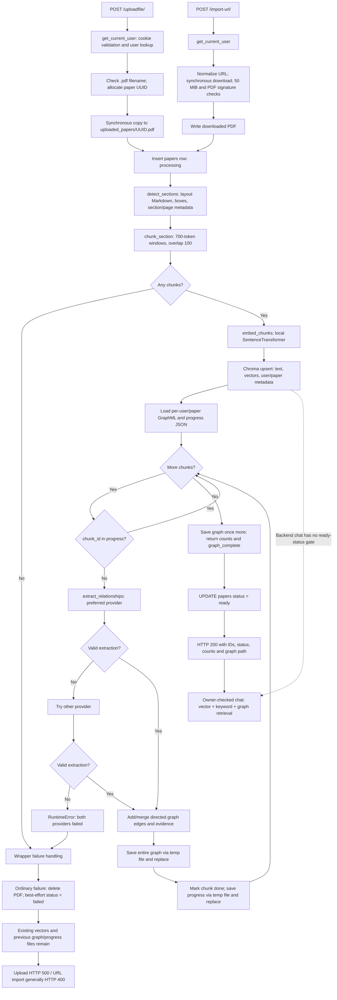

# PaperPilot: Complete PDF Ingestion Architecture Report

**Part 1 of 2: Pipeline, execution flow, and external providers**

Covers original sections 1-6. Section numbers are preserved for cross-references.

[Continue to Part 2](PDF_INGESTION_ARCHITECTURE_REPORT_PART_2.md) | [Original complete report](PDF_INGESTION_ARCHITECTURE_REPORT.md)


**Source review date:** 4 November 2026 (Asia/Karachi)  
**Project root:** `F:\paper pilot\project`  
**Scope:** Current backend ingestion, its authentication/storage dependencies, and the handoff to retrieval and chat. Frontend source was inspected only to establish what processing state is visible to users.

## 1. Scope, evidence, and investigation limits

This report is based on the current source files, not earlier versions of PaperPilot or comments describing intended behavior. Paths below are relative to the project root; for example, `backend/Graph_Rag/ingestion.py` means `F:\paper pilot\project\backend\Graph_Rag\ingestion.py`.

Only this requested report is an output artifact. No backend or frontend source, database, PDF, configuration, test, or dependency file was changed. No backend modules were imported or executed: importing several of them would create directories/databases, initialize provider clients, or load models. No upload, PDF conversion, model inference, provider request, database mutation, or new test was run.

Evidence labels used throughout:

- **Confirmed:** Explicit source behavior or a directly verified local configuration.
- **Conditional consequence:** What the confirmed implementation does under a stated input, failure, deployment, or concurrency condition. This is not a claim that the condition has occurred in production.
- **Not established:** Requires runtime measurement, credentials, a specific PDF, or deployment information not examined here.
- **Recommendation:** Proposed future design, not functionality that currently exists.

The local `backend/.venv` contains Groq 1.7.0, OpenAI 3.42.1, ChromaDB 1.5.9, PyMuPDF4LLM 1.28.2, and sentence-transformers 6.2.0 metadata. Relevant SDK implementation files were read to verify retry defaults. These observations do not prove that a separately deployed server uses this environment. Secret values, environment files, user records, document contents, authentication cookies, and API credentials were not read or reproduced.

Source anchors are function-definition or relevant call-site line numbers at review time. Line numbers can change after future edits.

## 2. Main findings

1. Upload processing is synchronous work inside an async HTTP handler. The request waits for text extraction, embeddings, vector storage, and a sequential graph-extraction loop.
2. Vectors are persisted **before** graph extraction. A later graph/provider failure can leave searchable vectors and earlier graph checkpoints on disk while the paper is marked `failed` and its PDF is deleted.
3. Each graph chunk not present in the progress set receives an LLM extraction attempt, including front matter and references. A valid empty extraction is still marked processed.
4. Extraction has two-provider fallback. Both providers failing raises `RuntimeError`; the ingestion loop catches Groq `RateLimitError` and `BadRequestError` instead. Those stop/skip handlers do not implement the intended provider-failure behavior for the current extractor.
5. Graph and progress files are separately replaced atomically, but are not one transaction. The order protects against marking an unsaved graph complete, but does not provide exactly-once processing.
6. There is no durable job queue, startup recovery, same-paper resume endpoint, upload idempotency key, or persisted per-stage error/progress record.
7. HTTP routes derive ownership from the authenticated cookie. Paper SQL operations and vector retrieval are owner-filtered; graph and checkpoint files are owner/paper scoped. No direct cross-user retrieval leak was confirmed in the inspected API paths.
8. Provider preference is process-global and shared across users. It affects availability/routing, not document isolation.
9. The graph is a `DiGraph`: multiple relations with the same directed source/target overwrite one another's relation label while combining evidence records. This is a confirmed evidence-integrity problem.
10. Storage roots are inconsistent: the paper registry, uploaded PDFs, and graph directory depend on the working directory; auth/chat SQLite and Chroma storage are anchored to the backend directory.
11. The durable paper states are only `processing`, `ready`, and `failed`. The upload response contains graph-completeness counters, but paper listing does not expose them and the frontend does not present a partial-ingestion state.
12. Chat error handling can convert operational failures into “answer not found,” and the backend's current confidence label differs from the frontend parser's expected label.

## 3. Complete execution flow

### 3.1 Startup and import-time dependencies

Before a request is handled:

- `backend/main.py` imports upload, question, authentication, and conversation modules.
- `backend/Graph_Rag/paper_registry.py` runs `initialize_db()` at module import and creates the `papers` table if needed in working-directory-relative `paperpilot.db`.
- `backend/api/upload.py` creates working-directory-relative `uploaded_papers/` at import.
- `backend/Graph_Rag/embeddings.py` loads `SentenceTransformer("all-MiniLM-L6-v2")` into a module-global model.
- `backend/Graph_Rag/vector_store.py` opens a persistent Chroma client at `backend/chroma_data` and obtains the `paperpilot_chunks` collection.
- `backend/Graph_Rag/graph_relationship.py` constructs Groq and OpenRouter clients. Both are constructed unconditionally.
- The question import chain loads the cross-encoder in `retriever.py` and another pair of provider clients in `answer_generator.py`.
- FastAPI's `lifespan()` calls `database.initialize.initialize_database()`, which creates auth/conversation/message tables and indexes and requests SQLite WAL mode.

Consequences: cold start includes model initialization, and missing provider credentials can prevent import/startup before fallback can run. “Fallback provider” does not mean its client is optional at initialization. Model cache availability, cold-download time, OCR availability, and startup latency were not measured.

### 3.2 Authentication and upload validation

**Entry:** `POST /uploadfile/` -> `backend/main.py:create_upload_file()` at line 111.

1. FastAPI requires a multipart `file` field.
2. `Depends(get_current_user)` reads and validates the HTTP-only authentication cookie and loads the current user from SQLite.
3. The route passes `current_user["id"]` to `upload_paper()`. No request-supplied `user_id` is used.
4. `upload_paper(file, user_id)` accepts a filename with a case-insensitive `.pdf` suffix.
5. A UUID4 becomes the `paper_id`; the on-disk name is `<paper_id>.pdf`, not the supplied filename.
6. `shutil.copyfileobj(file.file, saved_file)` copies the upload to disk synchronously.

**Important boundary:** The upload branch does not check MIME type, PDF magic bytes, file size, page count, encryption, or parser resource budgets before registration. `MAX_PDF_SIZE = 50 * 1024 * 1024` exists in this module but is enforced only in URL import. Frontend size checks are not backend enforcement.

The suffix check occurs before the function's `try/finally`, so the explicit `await file.close()` covers the main processing block, not the early invalid-filename branch. Framework-managed cleanup is separate.

### 3.3 Paper registration

After saving the file, `upload_paper()` calls:

```text
add_paper(paper_id, user_id, original_filename, relative_pdf_path, "processing")
```

`paper_registry.add_paper()` inserts into:

```text
papers(
  paper_id TEXT PRIMARY KEY,
  user_id TEXT NOT NULL,
  filename TEXT NOT NULL,
  file_path TEXT NOT NULL,
  status TEXT NOT NULL,
  created_at TIMESTAMP DEFAULT CURRENT_TIMESTAMP
)
```

The registry uses parameterized SQL and a connection transaction context. The insert is separate from all Chroma and graph writes. There is no `updated_at`, error text, progress count, stage, attempt count, file digest, pipeline version, or foreign key to `users`.

### 3.4 PDF text extraction

`upload_paper()` calls `process_paper(pdf_path, paper_id, user_id)`.

Its first operation is `detect_sections(pdf_path)` in `chunker.py`, which invokes:

```python
pymupdf4llm.to_markdown(pdf_path, page_chunks=True)
```

The application expects each page result to include:

- `metadata.page_number`;
- complete page `text`;
- `page_boxes` containing `class` and text-position offsets `pos`.

It slices each box from the page Markdown using those offsets. Non-empty box text drives all later processing; a full independent copy of every PDF page is not used as a fallback if box metadata is absent.

This is layout-assisted local extraction, not a Groq or OpenRouter call. The module imports `pymupdf.layout` before PyMuPDF4LLM.

**OCR qualification:** The application does not explicitly configure OCR. The locally inspected PyMuPDF4LLM layout wrapper defaults to `use_ocr=True`, `force_ocr=False`, and English OCR selection; its document parser disables OCR if no usable engine is available. It would be inaccurate to say “the app implements OCR” or “OCR is definitely absent.” Successful extraction from scanned PDFs was not established. The local layout implementation derives its page number from `page.number + 1`.

### 3.5 Section detection

`detect_sections()`:

- Skips boxes classified as `title`; document-title text is therefore omitted from the section body.
- Treats `section-header` boxes as heading candidates.
- Removes leading Markdown hashes and surrounding asterisks/spaces.
- Recognizes a set of common headings, such as abstract, introduction, methods, results, discussion, references, acknowledgements, and appendix.
- Also recognizes numeric headings matching the configured regex, such as `2.3 Method`.
- Before the first accepted section, stores regular text and unrecognized headers in `Front Matter`.
- After a section exists, accepts subsequent boxes classified as section headers without requiring membership in the common-heading set.
- Associates body text with the most recent section, preserving text per page.

Returned section shape:

```text
{
  section: string,
  page_start: page number or None,
  page_end: page number or None,
  page_texts: {page_number: text},
  text: accumulated section text
}
```

A heading is stored as the section name rather than repeated in that section's body text. Heading-only sections can remain in the section count but generate no chunks. An unknown header on the first page is not necessarily treated like that same header after a recognized section. These are explicit heuristics, not semantic section classification by an LLM.

### 3.6 Token chunking

`chunk_section(sections, paper_id, chunk_size=700, overlap=100)`:

1. Validates positive chunk size and `0 <= overlap < chunk_size`.
2. Sorts each section's page texts by page number.
3. Uses `tiktoken.get_encoding("cl100k_base")` to tokenize page text.
4. Builds a parallel array mapping each token to its page.
5. Creates sliding windows of up to 700 tokens, advancing by 600 tokens.
6. Decodes and strips each window, skipping an empty decoded result.
7. Assigns monotonically increasing, paper-wide chunk indexes.

Returned chunk shape:

```text
{
  chunk_id: "<paper_id>_chunk_<index>",
  paper_id: string,
  section: string,
  page_start: minimum page represented in this token window,
  page_end: maximum page represented in this token window,
  chunk_index: integer,
  text: string
}
```

Chunks never intentionally cross a detected section boundary. They can cross pages inside a section. Boundaries are token windows, not sentence/paragraph boundaries. No PDF coordinates or exact quote-page offsets survive into a chunk; a graph quote later inherits the entire chunk page range.

If no chunks result, `process_paper()` raises `ValueError("No text chunks were extracted from the PDF.")`.

For a non-empty section containing `T` tokens, assuming non-empty decoded windows:

```text
chunks(T) = 1 + ceil(max(0, T - 700) / 600)
N = sum(chunks(T_section)) across non-empty sections
```

The formula is a source-derived count, not a measured count for a particular PDF.

### 3.7 Embedding generation

`embed_chunks(chunks)`:

- Rejects any chunk with empty/whitespace-only text.
- Builds a list of all chunk texts.
- Calls the global model's `encode(texts, normalize_embeddings=True)`.
- Returns new chunk dictionaries with `embedding: embedding.tolist()`.

This is a local sentence-transformer model call, not one hosted LLM request per chunk. The code makes one `encode()` invocation for the complete list; this does not imply that the library uses one internal tensor batch. The application does not specify its own encode batch size, device, maximum sequence length, or memory policy.

The cached model's `sentence_bert_config.json` contains `max_seq_length: 256`. That is a model-tokenizer budget, whereas chunking uses 700 `cl100k_base` tokens. The application does not reconcile those budgets. Actual runtime truncation proportions were not measured; not every pair of tokenizers produces the same token count. Production chunk sizing should be verified against the embedding model's tokenizer rather than assuming all 700 tokens are represented in the vector.

### 3.8 Vector storage

`store_chunks(embedded_chunks, user_id)`:

- Validates required chunk fields and non-empty embeddings.
- Builds arrays of all IDs, embedding lists, text documents, and metadata.
- Performs one `collection.upsert(...)`.
- Returns the number of chunks.

Persistence:

```text
Directory: <absolute backend directory>/chroma_data
Collection: paperpilot_chunks
Record ID: <paper_id>_chunk_<index>
Metadata: user_id, paper_id, section, page_start, page_end
Document: complete chunk text
Embedding: explicitly supplied normalized vector
```

The application does not ask Chroma to generate embeddings because it supplies them. It does not explicitly persist `chunk_index` as a metadata field; the ordinal is encoded in the ID. It does not store an embedding-model or chunker-version identifier.

Upsert avoids inserting a second record for the same exact ID. It does not delete obsolete higher-index chunks if a later same-paper run produces fewer chunks. There is no content fingerprint or fresh-versus-retry distinction.

### 3.9 Graph loading and processed-chunk tracking

Only after embeddings and vector upsert, `process_paper()` loads:

```text
graph_data/<user_id>/<paper_id>.graphml
graph_data/<user_id>/<paper_id>_progress.json
```

Both locations are relative to the process working directory.

- Missing graph -> new `networkx.DiGraph()`.
- Missing progress -> empty set.
- Existing graph -> `nx.read_graphml()`.
- Existing progress -> `set(json.load(file))`.

There is no validation that the graph and progress belong to the current PDF content, chunker version, model version, or exact chunk text. Corrupt graph/XML or progress/JSON errors propagate.

The loop checks each current `chunk_id` against the progress set and skips its LLM extraction when present. This skip does **not** skip PDF extraction, chunking, embedding, or vector upsert.

### 3.10 Entity and relationship extraction

For each remaining chunk:

```text
extract_relationships(chunk["text"])
```

Only the text is submitted to the LLM. User ID, paper ID, section and page metadata are not included as separate extraction-message fields. Ownership is maintained by the caller and persistence paths, not by model output.

The prompt requests:

- Only explicit factual relationships.
- Exact short quotations as evidence.
- No instructions followed from the document text.
- At most 10 entities and 10 relationships.
- Empty arrays if nothing is supported.

The strict JSON schema requires:

```text
{
  entities: [string],
  relationships: [
    {source: string, relation: string, target: string, evidence: string}
  ]
}
```

The schema does not set array `maxItems`; “at most 10” is a prompt instruction, not an enforced validator limit. `validate_relationship_result()` checks container types, filters non-empty string entities, and keeps only relationships with four non-empty string fields. It does not enforce quote membership in the supplied chunk, relation truth, endpoint membership in the entities array, normalized entity names, or maximum counts.

A response with every malformed relationship removed can become an accepted empty extraction. The corresponding chunk will still be marked processed.

Provider routing and failures are detailed in section 6.

### 3.11 Graph construction

`add_relationships(graph, extracted_data, page_start, page_end, section)`:

- Iterates only `extracted_data["relationships"]`.
- Creates source and target nodes implicitly by adding directed edges.
- Does not add standalone entries from `entities`.
- Creates an evidence record containing quote, section, page start, and page end.
- Reads and merges existing `evidence_records`, deduplicating by exact dictionary equality.
- Writes the relation label, serialized evidence records, and top-level section/page fields to the edge.

Important structure:

```text
DiGraph edge key: (source, target)
Edge attributes:
  relation
  evidence_records = JSON string of [{evidence, section, page_start, page_end}]
  section, page_start, page_end
```

Because the key excludes the relation, `A -> B : improves` followed by `A -> B : depends on` becomes one edge labeled `depends on`, containing evidence accumulated for both. Retrieval reads this final relation label for every evidence record. That can associate an old quotation with a different relation.

There is no `chunk_id` in graph evidence, so evidence cannot be reliably removed/rebuilt per changed chunk using the persisted graph alone.

### 3.12 Graph and checkpoint persistence

For every successfully handled, unprocessed chunk:

1. `save_graph()` writes the **entire** graph to `<paper_id>.graphml.tmp`.
2. `os.replace()` replaces `<paper_id>.graphml`.
3. The chunk ID is added to the in-memory progress set.
4. `save_processed_chunks()` writes the entire sorted progress set to `<paper_id>_progress.json.tmp`.
5. `os.replace()` replaces the progress JSON.

After the loop, `save_graph()` runs once more, including when all graph chunks were skipped.

Replacing each file individually protects against exposing a partially written target file during a normal replace. It does not make the two files a single transaction, provide a writer lock, or guarantee power-loss durability with explicit fsync. Identical `.tmp` names are shared by simultaneous executions of the same user/paper.

`graph_store.py` defines `save_processed_chunks()` twice, at lines 50 and 64. The later definition replaces the former at import time. They implement the same effective persistence behavior; there is no two-step save or extra protection from having both.

### 3.13 Completion, status update, and API response

`process_paper()` returns:

```json
{
  "paper_id": "<generated ID>",
  "sections": "<number of detected sections>",
  "chunks": "<number of embedded chunks>",
  "processed_graph_chunks": "<size of stored progress set>",
  "graph_complete": "<progress-set size equals current chunk count>",
  "graph_path": "graph_data/<user_id>/<paper_id>.graphml"
}
```

Values shown in angle brackets above describe the real values' meaning, not literal response strings.

The wrapper then updates the registry status to `ready` and returns HTTP 200 with:

- `message`: upload/import success wording;
- `paper_id`;
- `filename`;
- `status: "ready"`;
- the processing-result fields.

There is no HTTP 202 background-job handoff. The wrapper does not condition `ready` on `graph_complete`. The count/boolean are response-only; they are not stored in the paper table or returned by `GET /papers/`.

In the normal, consistent-checkpoint success path, every chunk is added to progress and `graph_complete` is true. A provider exhaustion currently throws rather than returning a gracefully partial result. A true flag means the chunks were evaluated, not that every chunk yielded relationships or that extracted relationships were semantically verified.

### 3.14 URL import: alternate entrance into the same pipeline

`POST /import-url/` -> `main.import_pdf_url()` -> `upload.import_paper_from_url(pdf_url, authenticated_user_id)`.

Before registration:

1. `get_pdf_url()` converts recognized arXiv paths to a PDF URL.
2. URL parsing requires HTTP(S) and a hostname.
3. A fresh UUID is allocated.
4. Synchronous `requests.get(..., timeout=30, stream=True)` downloads bytes.
5. An 8,192-byte iteration loop accumulates the **whole** PDF in a bytearray.
6. Download is rejected when it exceeds 50 MiB.
7. The buffer must begin with `%PDF-`.
8. The complete buffer is written to the local PDF path.
9. A `processing` paper row is inserted.
10. The same `process_paper()` path runs and a normal return is marked `ready`.

There is no download retry loop or configured requests Session/retry adapter. The timeout is not a full end-to-end download deadline. There is no private-address restriction or redirect-target validation. The source accepts arbitrary HTTP(S) hostnames reachable from the server; this is a confirmed missing SSRF control, not evidence that an internal service was accessed.

The backend arXiv regex itself does not robustly distinguish an already suffixed PDF ID from a bare ID before appending `.pdf`; the current frontend normalizes modern arXiv PDF links to abstract links. Legacy slash-style IDs are not fully supported by this backend matcher.

### 3.15 Handoff to chatting

Two backend paths can use ingested data:

```text
POST /papers/{paper_id}/ask
  -> verify owner in registry
  -> answer_paper_question()
  -> ask_paper()

POST /conversations/{id}/messages
  -> verify conversation owner
  -> require its paper_id
  -> verify paper owner
  -> load existing messages
  -> persist new user question
  -> answer_paper_question(..., conversation_history=history)
  -> persist assistant response
```

`get_paper_for_user()` returns filename/path only; it does not check status. Neither backend path enforces that ingestion is `ready`. An owned failed/processing paper can therefore be queried directly through the API if vectors already exist. The frontend, by contrast, normally permits questions only when the selected paper status is `ready`.

Retrieval uses:

1. Owner/paper-filtered Chroma `collection.get()` to load all stored text/metadata.
2. Per-question BM25 over that paper's documents.
3. Local `embed_query()` and owner/paper-filtered semantic search.
4. Reciprocal rank fusion and cross-encoder reranking.
5. Owner/paper-specific graph loading.
6. Reading all graph edge evidence records and reranking them.
7. Returning up to the requested number of chunks and relationships, normally five each.
8. `generate_answer()` makes the answer-model request using retrieved evidence and up to the last 10 history messages for reference resolution.

There is no need for a complete graph to retrieve vectors. A missing graph becomes an empty graph. A corrupt graph can still make retrieval fail; the higher answer layer generally converts failures to the standard “not found” text rather than surfacing an operational error.

## 4. Mermaid execution flow

Solid paths describe the current implementation, including the failure behavior.



The chart's cleanup branch describes the ordinary exception path. HTTPException and cleanup-failure exceptions have the special behavior listed in section 7.

## 5. Function call hierarchy

```text
main.lifespan
  database.initialize.initialize_database
    database.connection.get_connection

Import-time initialization
  paper_registry.initialize_db -> paper_registry.connect_db
  embeddings: SentenceTransformer(...)
  vector_store: chromadb.PersistentClient -> get_or_create_collection
  graph_relationship: Groq(...), OpenAI(...)
  retriever: CrossEncoder(...)
  answer_generator: Groq(...), OpenAI(...)

POST /uploadfile/
  auth.dependencies.get_current_user
    auth.security.decode_access_token -> get_secret_key -> JWT validation
    auth.auth.get_user_by_id -> database.connection.get_connection
  main.create_upload_file
    api.upload.upload_paper
      shutil.copyfileobj
      paper_registry.add_paper -> connect_db
      ingestion.process_paper
        chunker.detect_sections -> pymupdf4llm.to_markdown
        chunker.chunk_section -> tiktoken encode/decode
        embeddings.embed_chunks -> model.encode
        vector_store.store_chunks -> collection.upsert
        graph_store.load_graph -> nx.read_graphml or nx.DiGraph
        graph_store.load_processed_chunks -> json.load -> set
        for each chunk not in progress:
          graph_relationship.extract_relationships
            extract_with_groq
              client.chat.completions.create
              json.loads -> validate_relationship_result
            on failure: extract_with_openrouter (or reverse provider order)
              openrouter_client.chat.completions.create
              json.loads -> validate_relationship_result
          graph_relationship.add_relationships -> graph.add_edge
          graph_store.save_graph -> nx.write_graphml -> os.replace
          graph_store.save_processed_chunks -> json.dump -> os.replace
        graph_store.save_graph
      paper_registry.update_paper_status(..., ready) -> connect_db
      exception cleanup/status handling
      UploadFile.close

POST /import-url/
  auth.dependencies.get_current_user
  main.import_pdf_url
    api.upload.import_paper_from_url
      get_pdf_url -> urlparse -> regex normalization
      requests.get -> iter_content -> bytearray -> write PDF
      paper_registry.add_paper
      ingestion.process_paper [same subtree as above]
      paper_registry.update_paper_status
      exception cleanup
      response.close

GET /papers/
  main.get_papers -> api.questions.get_user_papers
    paper_registry.list_papers -> connect_db

GET /papers/{id}/pdf
  main.get_paper_pdf -> paper_registry.get_paper_for_user
  resolve/check file path -> FileResponse

Chat after ingestion
  main.ask_question OR conversations.routes.send_message
    paper_registry.get_paper_for_user
    [conversation path: get_conversation; get_conversation_messages; save_message]
    api.questions.answer_paper_question
      answer_generator.ask_paper
        retriever.retrieve_information
          collection.get [owner/paper filter]
          tokenize -> BM25Okapi
          embeddings.embed_query -> model.encode
          vector_store.search_chunks -> collection.query [owner/paper filter]
          _reciprocal_rank_fusion
          _format_chunk -> reranker.predict
          graph_store.load_graph -> read edge evidence -> reranker.predict
          clean_section_name
        answer_generator.generate_answer
          Groq completion
          on Groq rate limit: OpenRouter completion
          parse claims -> source labels -> section/page citation lines
        calculate_confidence -> clean_section_name, format_pages
    [conversation path: save_message for assistant]
```

`graph_relationship.create_graph()` is defined but is not called by ingestion. Graph creation actually happens in `graph_store.load_graph()` when the GraphML file is absent.

## 6. External providers, models, retries, and request counts

### 6.1 All hosted completion call sites in the inspected backend

| File and exact function | Provider/model string | Output limit set in code | When called |
|---|---|---|---|
| `backend/Graph_Rag/graph_relationship.py:138`, nested `extract_with_groq()` | Groq, `openai/gpt-oss-120b` | `max_completion_tokens=4096` | One extraction attempt for an unprocessed chunk when selected in provider order. |
| Same file, line 161, nested `extract_with_openrouter()` | OpenRouter through OpenAI SDK; base URL `https://openrouter.ai/api/v1`; `openai/gpt-oss-120b` | `max_tokens=1500` | Preferred provider or fallback for that chunk. |
| `backend/Graph_Rag/answer_generator.py:269`, `generate_answer()` | Groq, `MODEL = "openai/gpt-oss-120b"` | `max_completion_tokens=1500` | Chat answer, not ingestion. |
| Same file, line 284, `generate_answer()` | OpenRouter, `openrouter/free` | `max_tokens=4096` | Chat fallback only after Groq `RateLimitError`. |

All four calls set `temperature=0`. Extraction requests strict `json_schema` output from both providers. Groq answer generation requests `json_object`; its OpenRouter fallback does not explicitly request JSON response formatting even though the prompt asks for it.

These are the literal model identifiers configured by the app. Provider availability, actual routing behind `openrouter/free`, account quotas, context limits, pricing, and whether a provider currently accepts all options were not probed. The code does not establish that OpenRouter is always free or unlimited.

### 6.2 Extraction fallback and global preference

At process initialization, `use_openrouter = False`.

- Initially try Groq, then OpenRouter.
- If OpenRouter succeeds, future chunks try OpenRouter first.
- If a later Groq fallback succeeds, future chunks try Groq first.
- Both providers are attempted at most once each at the application layer for a given extraction invocation.
- Empty output, JSON errors, validation errors, rate limits, transport errors, and other ordinary exceptions can trigger fallback.
- Groq `RateLimitError` gets a specific log message; OpenAI/OpenRouter exceptions are covered by the broad `except Exception`, not the Groq-specific class.
- If neither succeeds, aggregate error descriptions are put into a new `RuntimeError`.

There is no application cooldown timer, per-user quota, provider semaphore, Retry-After handling, or exponential-backoff loop here. A failed provider is not disabled permanently; it remains the second choice on subsequent invocations. Preference is shared by every paper/user handled in that process and resets on restart.

### 6.3 Application retries versus SDK retries

The absence of an application retry loop does **not** mean each SDK call makes exactly one HTTP request.

In the inspected local SDK files:

| Local SDK evidence | Groq | OpenAI SDK used for OpenRouter |
|---|---|---|
| `_constants.py: DEFAULT_MAX_RETRIES` | 2 | 2 |
| Default timeout object | 60-second general timeout, 5-second connect timeout | 600-second general timeout, 5-second connect timeout |
| Retry policy in `_base_client.py` | Network/timeouts; HTTP 408, 409, 429, and >=500, subject to retry headers | Same main classes; also rejects retry when a parsed Retry-After exceeds its maximum |
| Backoff | Initial 0.5 s, exponential growth, cap 8 s, jitter | Initial 0.5 s, exponential growth, cap 8 s, jitter |
| Honored Retry-After range in inspected implementation | Positive delay <=60 s | Positive finite delay <=120 s |
| Application overrides | None supplied | None supplied |

Thus one provider-method invocation can make up to three HTTP attempts for retryable failures under those defaults. SDK timeout objects are not complete-paper latency guarantees. A successful HTTP response with invalid JSON is not an SDK transport retry; the application instead tries the other extraction provider.

These defaults apply if the reviewed SDK/environment is the one used by the server. No backend dependency lock/requirements manifest was found in the inspected project file listing, so reproducing runtime dependency behavior requires explicitly recording/pinning the deployed versions.

### 6.4 Requests for a typical PDF

There is no fixed “requests per page” rule. Let:

- `N`: current number of chunks;
- `P`: current chunk IDs already represented in the progress set;
- `A`: chunks actually visited for extraction before the loop completes or aborts, with `A <= N - P`;
- `F`: visited chunks that also attempt the fallback provider.

Then:

```text
Extraction application-level provider calls = A + F
Normally, first-pass success = N calls
Normally, successful same-content graph resume = N - P calls
Application upper bound for visited chunks = 2A calls
Retryable HTTP-attempt upper bound with reviewed SDK defaults = 6A attempts
```

A successful provider's valid empty arrays count as one handled chunk. A PDF with no extracted chunks causes zero extraction LLM calls. A graph checkpoint does not eliminate local embedding work on a retry.

**Illustrative example, not a measured paper:** A PDF producing 50 chunks needs 50 extraction calls if the preferred provider succeeds for every chunk. If eight visited chunks need the other provider too, there are 58 SDK completion invocations before any SDK-internal retries. If the progress set contains 30 matching chunk IDs, graph extraction normally needs only 20 calls on a successful same-paper resume; extraction/chunking/embedding/upsert still rerun.

Both-provider failure aborts on the failing chunk. It is wrong to assume all remaining chunks will each receive six attempts after that failure.

Embeddings are local. A cold Hugging Face model load may require downloads if files are not cached, but this is not a Groq/OpenRouter extraction request and was not executed in this review. Chat normally adds one answer completion, or two application-level completion calls when Groq rate-limits and fallback is attempted; it is not part of the PDF-ingestion request count.

### 6.5 Sequential versus concurrent calls

The graph loop and both fallback attempts are synchronous and sequential. There is no thread pool, asyncio task fan-out, chunk concurrency, or explicit provider-wide request limiter in the pipeline.

The HTTP wrapper being `async def` does not make `copyfileobj`, PyMuPDF conversion, `model.encode`, Chroma upsert, synchronous SDK requests, SDK retry sleeps, or GraphML writes non-blocking.

---

[Continue to Part 2](PDF_INGESTION_ARCHITECTURE_REPORT_PART_2.md)
